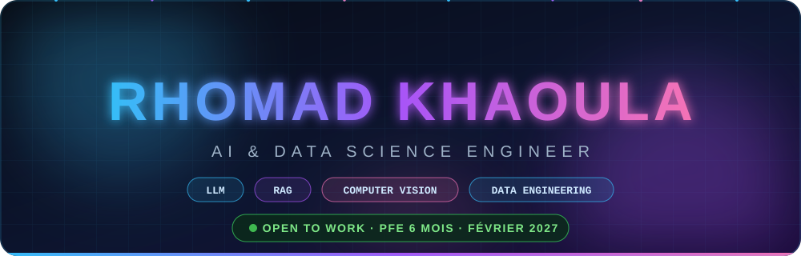

<div align="center">



<a href="https://git.io/typing-svg">
  
</a>

<br/><br/>

[](https://portfolio-rhomad-khaoula.netlify.app)
[](mailto:rhomadkhawla@gmail.com)


</div>

<table align="center" border="0">
<tr>
<td align="center" width="230">


</td>
<td>

### 👋 Salut, moi c'est **Rhomad Khaoula**

Étudiante en **5ᵉ année d'ingénierie informatique à l'EMSI (Rabat)**, spécialisée en **Intelligence Artificielle & Data Science**.

Je conçois des solutions intelligentes de bout en bout, de la donnée brute jusqu'à l'application : assistants **LLM + RAG**, **vision par ordinateur** et pipelines de données.

🎯 **Je cherche un stage PFE de 6 mois** en Data Science & IA, à partir de **février 2027**.

</td>
</tr>
</table>

<div align="center">




</div>

## 🧠 Ce que je fais

<table>
<tr>
<td width="33%" valign="top">

### 🤖 IA générative
LLM, RAG, embeddings, agents, recherche sémantique et réponses en langage naturel sur données structurées et documentaires.

</td>
<td width="33%" valign="top">

### 👁️ Computer Vision
Détection d'objets en temps réel avec YOLOv11 et classification d'images médicales par Deep Learning.

</td>
<td width="33%" valign="top">

### 📊 Data & BI
Pipelines ETL/ELT, data warehousing, PySpark, Talend, tableaux de bord Power BI (DAX, KPI).

</td>
</tr>
</table>

<div align="center">


## 🛠️ Stack technique



<br/>


<br/>


</div>

## 💼 Parcours

```text
2026  ●━━ ONCF ........ Stagiaire IA & Data Science  → Assistant intelligent (RAG)
2025  ●━━ DIDH ........ Stagiaire Full-Stack          → Gestion documentaire & archives
2024  ●━━ EMSI ........ Cycle d'ingénieur             → Informatique et réseaux
2022  ●━━ EMSI ........ Classes préparatoires         → Deux années préparatoires
```

<details open>
<summary><b>🚆 ONCF — Stagiaire IA & Data Science · Juil. – Août 2026</b></summary>
<br/>

Conception et développement d'un **assistant intelligent pour la gestion des conventions de dettes** : interrogation en langage naturel de données structurées et documentaires (recherche sémantique et réponses en langage naturel).

- Backend **FastAPI**, frontend **React**
- Intégration d'**Oracle**, **PostgreSQL**, **PGVector**, **LangChain**, **LangGraph**, **BGE-M3** et **Qwen / Ollama**

`Python` `FastAPI` `React` `LangChain` `LangGraph` `PGVector` `Oracle` `PostgreSQL` `Ollama`

</details>

<details>
<summary><b>🗂️ DIDH — Stagiaire Full-Stack · Juil. – Août 2025</b></summary>
<br/>

Conception d'un **système de gestion des documents et des archives** pour moderniser et automatiser la gestion documentaire d'une organisation.

`PHP` `HTML` `CSS`

</details>

## 🚀 Projets

<table>
<tr>
<td width="50%" valign="top">

### 🎯 Détection d'objets en temps réel
Détection de plusieurs classes (personne, bouteille, chaise, téléphone) avec entraînement sur un jeu de données personnalisé.

`Python` `YOLOv11` `Deep Learning`

</td>
<td width="50%" valign="top">

### 🫁 Détection de pneumonie
Prétraitement des données, entraînement, évaluation et test d'un modèle sur radiographies thoraciques.

`Python` `Deep Learning`

</td>
</tr>
</table>

<div align="center">

👉 Retrouve mes autres projets dans mes dépôts épinglés et sur mon **[portfolio](https://portfolio-rhomad-khaoula.netlify.app)**


</div>

## 🏅 Certifications

<div align="center">


## 📊 Statistiques GitHub


<br/>


<br/>


<br/><br/>


<br/>


## 🌍 Langues

🇲🇦 **Arabe** (maternelle) &nbsp;·&nbsp; 🇫🇷 **Français** (courant) &nbsp;·&nbsp; 🇬🇧 **Anglais** (intermédiaire)

<br/>

### 📫 Un projet IA ou une opportunité de stage ? Parlons-en !

[](https://portfolio-rhomad-khaoula.netlify.app)
[](mailto:rhomadkhawla@gmail.com)


</div>
